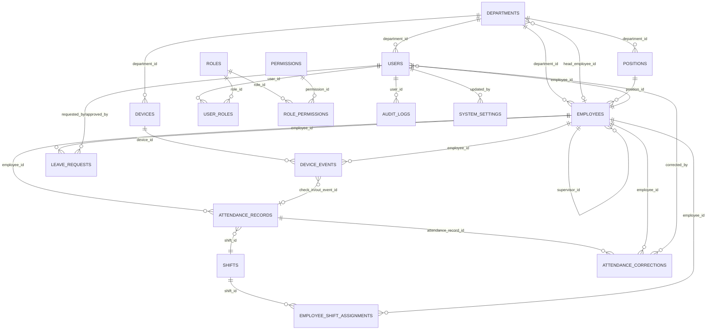

# FaceSys Enterprise — ER Diagram & Ma'lumotlar modeli

## ER Diagram (Mermaid)

## Jadval tavsiflari

| Jadval | Vazifasi | Asosiy kalitlar / Unikal |
|---|---|---|
| `departments` | Bo'limlar daraxti (parent_id) | `code`, `name` unikal |
| `employees` | Xodimlar; `internal_id` (ichki) va `device_user_id` (Hikvision) alohida | `internal_id`, `device_user_id` unikal |
| `positions` | Lavozimlar | `code`, `name` unikal |
| `users` | Tizim foydalanuvchilari | `username`, `email` unikal |
| `roles` | Rollar + cheklov bayroqlari | `name` unikal |
| `permissions` | Ruxsatlar katalogi | `name` unikal |
| `user_roles` | Foydalanuvchi–rol bog'lanishi | `(user_id, role_id)` unikal |
| `role_permissions` | Rol–ruxsat bog'lanishi | `(role_id, permission_id)` unikal |
| `devices` | Hikvision qurilmalari | `serial_number` unikal |
| `device_events` | Xom qurilma hodisalari (immutable-ish) | `(device_id, device_event_id)` unikal — idempotency |
| `attendance_records` | Kunlik hisoblangan davomat | `(employee_id, record_date)` unikal |
| `attendance_corrections` | Qo'lda tuzatishlar (audit bilan) | — |
| `shifts` | Smenalar, tungi smena bayrog'i | `code` unikal |
| `employee_shift_assignments` | Xodim–smena biriktirish (sana oralig'i) | — |
| `leave_requests` | Ta'til so'rovlari | — |
| `holidays` | Bayram/dam olish kunlari | `date` unikal |
| `audit_logs` | O'zgarmas audit jurnali | — |
| `system_settings` | Tizim sozlamalari (JSON) | `key` unikal |

## Muhim dizayn qarorlari

1. **Soft delete** — `employees`, `departments`, `positions`, `users`, `roles`, `shifts`, `attendance_records` va boshqalarda `is_deleted` + `deleted_at`. Xodim o'chirilganda davomat tarixi `ON DELETE CASCADE` emas — soft delete sababli saqlanadi. `device_events.employee_id` esa `SET NULL` — xom hodisa hech qachon yo'qolmaydi.

2. **Circular FK** — `departments.head_employee_id → employees.id` va `attendance_records.check_in_event_id → device_events.id` siklni oldini olish uchun jadval yaratilgandan keyin `ALTER TABLE ADD CONSTRAINT` bilan qo'shiladi.

3. **Idempotency** — `device_events` da `(device_id, device_event_id)` noyob kalit. Qurilma bir xil hodisani qayta yuborsa, `ON CONFLICT DO NOTHING`.

4. **Timezone** — barcha `DateTime` ustunlari `timezone=True` (TIMESTAMPTZ). Ilova darajasida `Asia/Tashkent` ga konvertatsiya qilinadi.

5. **Biometrika** — yuz shablonlari/rasmlar saqlanmaydi. Faqat `similarity` (float) va `verify_mode` saqlanadi.

6. **Audit immutability** — `audit_logs` uchun soft delete/updated_at yo'q; faqat INSERT (DB darajasida `REVOKE UPDATE/DELETE` tavsiya etiladi).

## Indekslar strategiyasi

- Qidiruv: `employees.name(last_name, first_name)`, `employees.internal_id`, `employees.device_user_id`
- Davomat: `attendance_records(record_date, status)`, `(employee_id, record_date)`
- Hodisalar: `device_events(employee_id, event_time)`, `(processed, event_time)`
- Audit: `audit_logs(user_id, timestamp)`, `(resource_type, resource_id, timestamp)`